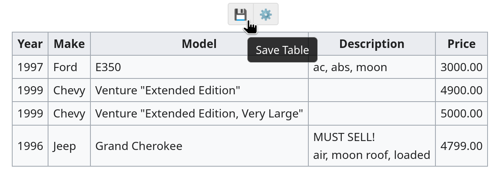
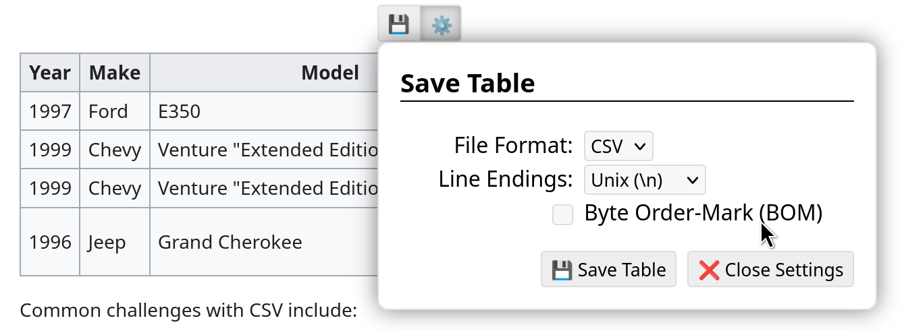
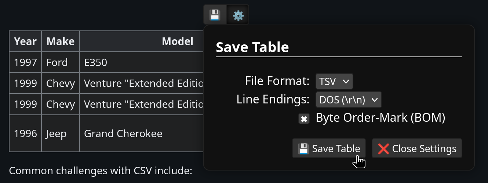

Save Tables
===========

A bookmarklet to add save buttons to tables on a website.

Its a bit big and Firefox didn't like it as-is as a bookmarklet, so I've compressed it (see [`make_bookmarklet.sh`](make_bookmarklet.sh)):

```
javascript:void(fetch('data:;base64,H4sIAAAAAAACA7Vae3fTOBb/n0/hdnZr66xjki7szDjHdJtHy6O0M7TA7gAnyLaSiDp21pb7oPi7772S7DhJ2yQFwpwhlq7u+/7ulUOQxJm4oVnGR3HhnfhfWCDaERMGzw5ij3rPxPWUJUODep5nDvM4EDyJzbZlEe/ZzXaeMSMTKQ/EdrvcNMZWx+7ajuMMAnKDrJgXJkE+YbFwgpRRwfoRwyerQ9p8aHXJMEmtABUxBtTgsdFV53pe98OAfkKaAXUyQVORvedibJmgAtnZgcWIxSMxfrZLUF2rR/aYQ8OwfwHcj3gmWMxSeTbiAbN2iQ0kxF1FE7NL40BbY5kMCU3b+Py3m17xmRDSZhGYDUpp1/TQNYn0nLmz09vyvDiPIlQPN0IqaMaESZSPLeboFbu3IadMXEesxkc+V1zAAh4HUR6yzDIbJnoChOwLiI6fCwYW2toC12IE/er1iprj9w1QACOG3t5Xkr99w2/eVosAkeBxztpaU7k+UxVOOHESsjPYhY1j+Or0j/qv+8dng+OTXh8ZLRGc9f+jdmXUplMWh90xj0JgJmNUW1nInzN2JZCFBRYN9jEoRcpEnsYGK6o09K2+SqOB74kxz5wgSjKWCct0GjxpjCCRcr8xpfFX3mhk9II1BPUj1hjl3CSyBAZdb+DvOf/LWXp9yiIwFdy1+jQ8MwHeGmWmzO+tgf/t29YAkppGLAX5/TRNUtc41VTG4dsXRpwIY5jkcbgFh5QxhQVnVJSdkGfTiF57ZpzEzGwP/EWtPsR0wrxS8CeIP9gLqYIZ7qRsklwwSIuVmlPw3QUr7Q+9KAlodAoS6Ig5IyZeCDaxTJ44io0j2TgzLs6QRwyyakIh4799M4PswlS82Oa8Ih4zSAHlSWCWx/xKcTvYnJmfTEyCSSvSnCkuh96AyRJNMnPP/Jh+jE3XhP/JzecemA+baMHe4w/2Nu5/ejxyH3/4KMoHhZR1SlNAbj7Gr676CtIhH6Y0hbwNGxc0ylmmJHyZO2ejbKF2zhcSVlqgk+l8MY3OcNNgClJvzSNkGXnnTkCnWBlSxASZReRGVT/d9z58aiMa4B7teBEEMs2ErL427cB/Hu04MRh0yn2Iy4jAcdoBhEJNd3ZwEwryGJIQ1szT7psXf5yZy+tn/z3qm6osabctedwLHAAttEMWkz0LUj4VtqERUfPrecgNnBYzCQ5bTcDqGcIxBDjam+e1H0XL7FhZMKRNux4cwUB2AQHBwYUEW1zu1JeBsEJruu9M82xs0S4pJh48fUk49BGTOIDFE4sUWxMwa+JVYZ14gGOTwgEwC4vPMjwxxuNgZydWrMyP+ZANh2bdHtpHg86dNLnMtAcOvK1mjSJgUSSN7jv4FajowR4StVzN94sqdHqIoUCaez1tG2sgp1bluaf4rQjH81XhWE9mPWKHHnBdjtihJ/WpxwzJoLzoIdmzSkdvm8TW3+khcAXUDZhUaxtKdBu2q32khWZaUUMX0t8Piay5xHv75ki3LDVZwbOcLjpR4luxbdxgO3V5AZ5RXpl6wJea9s04ZUM3scPkMo4SGroTW7rDvZkmGccqdk3qZ0kErd20kykNuLh2m0VB2lWv9JPweq6LTkl7CgHhwTn4CVrFGZ+wJBdqlpsCZKZwTM9me9qj1Uk0JWUXyXnNlIQUdutpk8yabmDRF7rrdjbvujZ96VmDzve1XN1zO9Bz6cuNe65UvecNOisbrESvlwv92dMdmtyMYFNX1ysPCR9uU4PHMKOiZfQVAuIrLRQ6rfDMpmlXKykfjWGJ5iIBBZe0M31om+em1PyVLtQjD05DA+2gI0BaN+IQ/jegJRbTkWLZuOQxpKIjFXnPQxy5lzWRYpeUaZqkGPTq4whM35vMIrKAb5aN0aNQ7/smnWKWvKFFX2uvHD8keU88evwDxkV6jKl7snHq0uOfPRRaoNWtUZj5cN+if2gf/rm5D3+E9/4kyh+q9t5A7f15u19gIgSXoE/GLDhnIXi91Z6bK7PNBl77TlEzIiVRjoF6PCaby6wPxncLrVHNS5Vz9APE4giNl0j6Bq5cs5ADmJxCsp46cEEHIPHKmRCWnWkqr889NqR5BIhiw1omkukfKfSsEZU3bGKHMJpCi8VjQEBqvAFFz3Q6vYVInq3jXpu+u5t0wSk2fX83rU6QNn2LxrxV/vshVyLVPN4R+u6hTG+/GyHX94S+L1P6e69Js0AMLHKj79gwoaA5MKTQQE0iX+gFVVOba9oSYXDgd1dCC0wucZb7Ey5cv7CBr58LkcTAWc5Fptoz7Vhyw7OmLbiAMcg8hQd19YGOk3J6RH0WzS1LhhnIRUWB4jkPQwbKKsNsGKlvWsMnPiswDZZll49adgkylfxqoS69WkxiOWe5wRpa7P7r998L+Pug3zwolQn5BRzYwJU1HCwnRQ3RroboSqdh8Z0S9Dwi2Yx3gQvYUXN8zQBJEqFzygftio3kYrY1cMRAhx1ANRkHspxcQ8nKZN0CVxWrOiKDzWMaj5i7L6Un8gIMlLLqXFmLtjrOQnerCfy7p+8U10VaAbSwf4b7hPxcI4+guo2+Ku87rJzrASvMlOCwYOdbWDOsjx9jcru5+FIEyHonp0iVKsKfbDew4PE0F1URShjzk6uyDGUH0tjmbrXqdivNtAageOdaMOMkDVnaeE3Tc8PqnLyWFjww+RUeZOY9OLUB4timsVgxd+BPWbXhOkjy65NAMe/i0FWNjDJwpKhuhtAI9DWvc/1iaRbP561v6Ncie7M7dsVozGg4d8VEFSV5aYZ+HQY5ykN3LUGF/fnRyrHPuHlkwAemBtfgMVyIadSWK9X12EhZRHFuVeugeDqMkkvXuOAZBy5qeQIjCwfiJv5xnoKF+i+1PUxiuPswvMi4MHMDpkS1jYx/Za7Rmqce0gmPrl0jo3EGiJnyodos0RjUxdJtyKuY2gqSCAf8C5pajWXD5S5pP5Kkd+27hh/Rkt8tRD5sjlK8MLjG5ZgLdjdlgjXjGr/05OdOOlmoQHbwG/65m51MY6Dry88KOn3VWC1dk/MYehKEeuRTq2kb+j9n9yn4q3j06N8TFnJqWDCFDlmaKVc1MgAQqHkjBFggOpHWTbj7Y1Dz7Bpx+KUlP/fTl9HYlZ97acuIPJGf+9mWUfmn/KxBO4vMGprcF50WUUcLDNBqt493tefrFefsliVXr98WFq9GARpiZ3TL57nK5PEYylLM1d7c2lzV+0kUquUyFjhO1VcgSGDuBPSaXhlZEvHQCPIU36V1kXl7LUMXpyttdT1f7sCHGQlZMH6GTFrRlIY8h4GiDnGlVTPl75IjCUl56qqRjWmIgFr6frEKn5JFSC7fWKp1uAaC2Gbz7+oRZ4AqYNg2GjTiIziFGzraPG5c4tsn19htlQZ8BYeF7EqyarY29bbr46zItLsD9WbYNba3F3Uf8isW1hRvlo5QsW/eYkSqMqh5i57N9fQ0ZE3baxCq4W4dSlWclcHL6f/QjFhIsd2nS0X6c4xev1QkY7KmFnN+WqcOJb32BgBAho6dJhwyKl1EJekcLJHSRfdMBzC4CA63+LIcJjD34fiyvis/4CjmlbP0p3J2grGNpjQO2Bykre/FH5s/uq6rsh5r/G3NgOoK8V86UNcpcLi6HfBXj4FjOT7f7+IVkXlQXi8Ewy1vM3QoKtSfwZC8MvxKWbG9AktreBmwWcrVoWoOmxZwax6qpKFVADaqF1fNCesDkbPu+2ftmyrSEK/A0pX0D0w2Ui7hSmNuZXd5aXasvVmFa3VuaYRy3imvEsD+fjaSel0wembod/mwXBZwibjl7WRhKoHQq70ZJt8ytSyTbKZP+dvCvE4oG9PtftGLFOt17uqFgRZZT31pzBye/LYGwtaGSBm35vrK6LcCWpVKxjBiV/O8W6liXHpiRKduvQHgiUbIUxZo2Eou1caXPBN8eN2oMEFSwoUbVfw895M6/Qt/U68u58u/rOt/cKBeqPv7Hv2r+jchW/7+zo4Fa3CD12v4k9Zf+AYfr/ewtfzzvb9/i5ANf68HHnP/9ssipCgIbDz6P6LuKqibKAAA').then(r=>new Response(r.body.pipeThrough(new DecompressionStream('gzip'))).text().then(eval)))
```

Add a bookmark with the code above as the link. Then when you click the bookmark
it will add save buttons to all tables on the currently viewed website:



There are a few settings for CSV/TSV, line endings, and byte-order mark:



The settings are saved in local storage, i.e. per-website.

Automatic dark-mode is also supported:


